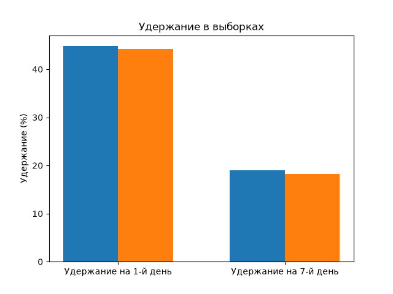
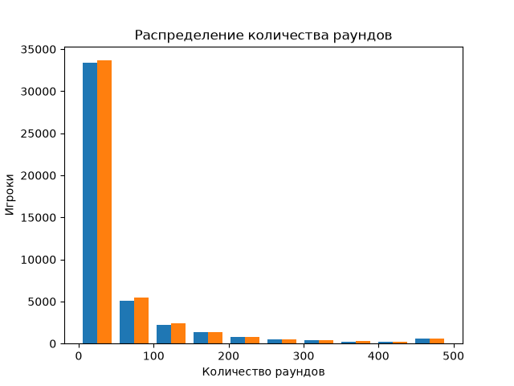

# Cookie Cats — A/B-тест удержания игроков

## Бизнес-запрос
В мобильной игре Cookie Cats ограничение прогресса (gate) перемещено с 30-го на 40-й уровень. По данным A/B-теста требуется оценить влияние изменения на удержание игроков на 1-й и 7-й день и изучить количество сыгранных раундов. Следует ли менять ограничение с 30 на 40?

## Состав данных
| Поле | Назначение |
|---|---|
| userid | уникальный ID игрока |
| version | контрольная или тестовая выборка |
| sum_gamerounds | количество сыгранных раундов |
| retention_1 | вернулся ли игрок через 1 день |
| retention_7 | вернулся ли игрок через 7 дней |

## Ход работы
1. **Контроль качества:** проверены пропуски, уникальность пользователей, значения групп, отрицательные раунды. Итог: 90.189 строк, 0 пропусков, 0 повторяющихся идентификаторов пользователей.
2. **Описательный анализ:** подсчитаны численности групп, число вернувшихся, удержание на 1-й и 7-й день, среднее, медиана, 95/99-й процентили раундов; сохранено в outputs/group_summary.csv.
3. **Статистические гипотезы:** для каждой метрики H0: p_test = p_control; H1: p_test ≠ p_control. Двусторонняя проверка, α = 0,05. Разница определяется как тест минус контроль.
4. **Статистический тест:** z-тест двух независимых долей. Для каждой разницы рассчитан 95%-й доверительный интервал, p-value по двум проверкам скорректированы методом Холма.
5. **Анализ активности:** сравнение средних, медиан и процентилей раундов; тест Манна - Уитни. Выявлен экстремальный максимум 49.854 раунда в контрольной выборки: удалять его без подтверждения ошибки нельзя. На графике значения выше 99-го процентиля показаны на границе шкалы.
6. **Рекомендации**: не внедрять gate 40 для всех игроков на основании представленного теста; у 7-дневного удержания в тестовой группе статистически значимое ухудшение, роста удержания нет.

Python-скрипт проверяет данные, рассчитывает метрики и статистические тесты, сохраняет CSV в outputs, диаграммы в images.

## Удержание игроков в выборках

## Распределение количества раундов

## Результаты

| Удержание | Контрольная выборка | Тестовая выборка | Разница, % | 95%-й доверительный интервал разницы | p-value |
|---|---|---|---|---|---|
| На 1-й день | 44,82% | 44,23% | -0,591 | [-1,239; +0,058] | 0,07441 |
| На 7-й день | 19,02% | 18,20% | -0,820 | [-1,328; -0,312] | 0,00155 |

Изменение удержания на 7-й день составляет -4,31% относительно контрольной выборки. Разница статистически значима с учётом поправки Холма на две проверки. Для удержания на 1-й день доказательств различия при α = 0,05 нет.

Количество раундов (контроль и тест): среднее 52,46 и 51,30, медиана 17 и 16. Разведочный тест Манна - Уитни p ≈ 0,0502; это не основание заявлять ни о статистически значимом улучшении, ни о падении среднего количества раундов. Данные сильно асимметричны и содержат выброс.

Размеры групп 44.700 и 45.489 не равны. Следует проверить исходный алгоритм распределения. Если целевая пропорция была другой, то такой тест неинтерпретируемый.

## Рекомендации
Не внедрять gate 40 для всех игроков на основании представленного теста. У 7-дневного удержания в тестовой группе статистически значимое ухудшение, роста удержания нет.
